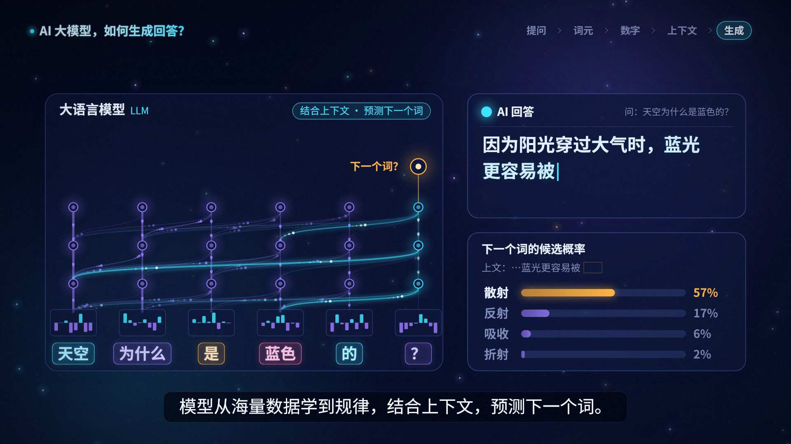

# 《AI 大模型，如何生成回答？》20 秒动画科普短片

一条连续的视觉旅程：**一句提问 → 切分成 token（词元）→ 数字表示（ID / 向量）→ 模型结合上下文处理（多层网络 + 注意力连线）→ 回答逐字生成 → 提醒“流畅 ≠ 正确”**。

核心观点只有一个：大语言模型从大量数据中学习规律，根据上下文逐步生成回答；表达流畅不代表一定正确。



## 成品

| 文件 | 说明 |
| --- | --- |
| `output/llm_explainer_20s.mp4` | 成片：20.0 秒，1920×1080，30 fps（600 帧），H.264 High / yuv420p，AAC 48 kHz 立体声，`+faststart`，字幕已烧录 |
| `output/subtitles.srt` | 独立字幕文件（与烧录字幕同一时间轴） |
| `output/stills/*.png` | 关键时刻静帧（t = 1 / 5 / 9 / 13 / 17 / 19.5 秒，从成片抽取） |
| `assets/audio/narration_0X.wav` | 逐句旁白（已去静音、压缩停顿、统一变速） |
| `assets/audio/raw/*.mp3` | TTS 原始音频缓存（按文本哈希命名，离线重建时复用） |
| `assets/audio/music.wav` | numpy 合成的背景音乐 |
| `assets/audio/mix.wav` | 最终混音（人声 + 自动闪避的音乐） |
| `assets/audio/timeline.json` | 每句旁白的实际起止时间，**画面与字幕时间轴都由它驱动** |
| `assets/fonts/` | Noto Sans SC（思源黑体）Regular / Bold 子集 + OFL 许可证 |

## 分镜（以当前旁白实测时长为准）

| 时间 | 旁白 / 字幕 | 画面 |
| --- | --- | --- |
| 0.0 – 1.3 s | （片头音乐） | 深蓝渐变背景、星点粒子、光环轨道；标题《AI 大模型，如何生成回答？》逐字浮现，渐变光线展开，副标题出现 |
| 1.3 – 3.0 s | ① 你问一句话，模型先把它切成 token。 | 标题平滑缩小移到左上角成为页眉；右上角出现 5 步进度条（提问 › 词元 › 数字 › 上下文 › 生成）；中央对话气泡里逐字打出“天空为什么是蓝色的？” |
| 3.0 – 4.9 s | （续 ①） | 青色扫描线横扫句子，在词元边界处闪出切口光环；文字散开成 6 个彩色 token 卡片：天空 / 为什么 / 是 / 蓝色 / 的 / ？ |
| 4.9 – 7.8 s | ② 每个 token 都会变成一串数字。 | 卡片上移，每个 token 下方“掉落”一个数字 ID（数字滚动计数），随后展开为一条向量柱状条 |
| 7.8 – 10.3 s | ③ 模型从海量数据学到规律，…… | 卡片与向量下沉成为“大语言模型”面板的输入层；三层网络节点依次弹出；右侧浮现“海量文本数据”词云（瑞利散射、书籍、网页、代码……），逐个拖着光尾飞入网络被吸收，节点随之闪亮 |
| 10.3 – 11.8 s | ……结合上下文，…… | 注意力连线逐层生长：最后一个位置（“？”）的连线变为青色高亮并加粗，重点连向“天空”“蓝色”；光点沿连线流动 |
| 11.8 – 13.7 s | ……预测下一个词。 | 顶部出现琥珀色“下一个词？”输出节点；右侧出现“AI 回答”面板，答案开始逐个 token 飞入；在“蓝光更容易被 ___”处暂停，下方弹出候选概率条：散射 62% / 反射 21% / 吸收 9% / 折射 5% |
| 13.7 – 15.7 s | ④ 回答就这样逐字生成。 | “散射”被选中并从概率面板飞入答案；其余 token 依次从输出节点带拖影飞出，每生成一个，网络就亮起一次计算波 |
| 16.0 – 19.3 s | ⑤ 但要记住：说得流畅，不一定正确。 | 模型淡出，回答面板移到画面中央放大，边框变琥珀色；弹出警示胶囊“⚠ 流畅 ≠ 正确，重要信息请核实”（呼吸光晕）；琥珀色“核实”下划线逐行扫过答案 |
| 18.2 – 20.0 s | （片尾） | 底部出现总结句“大模型：从数据中学习规律 · 根据上下文逐步生成”；最后 0.45 秒整体淡出 |

> 画面中的 token 切分、ID、向量、注意力权重与概率均为**示意数值**，不对应任何真实模型的词表或输出。

## 一键重建

```bash
cd video/llm-explainer
./build.sh
```

`build.sh` 依次执行：

1. `src/tts.py`：逐句合成旁白，去首尾静音、压缩句内长停顿，自动计算统一的 `atempo`（上限 1.25）使旁白落在约 1.3–19.25 秒内，句间留 0.3 秒；输出 `timeline.json` 与 `output/subtitles.srt`。
2. `src/music.py`：numpy 合成 D 大调氛围 pad（Dmaj9 → Bm9 → Gmaj7 → A6sus）+ 柔和琶音 + 低频脉冲 + 卷积混响，淡入淡出。
3. `src/mix.py`：按时间轴摆放旁白；人声期间音乐 RMS 比人声低 20 dB，无人声时低 12 dB（平滑闪避）；最终峰值归一到 -1.5 dBFS。
4. `src/render.py`：skia 逐帧绘制，4 进程分批渲染、以原始 RGB 管道送入 ffmpeg（不落地中间帧），编码并混入音频。
5. 从成片抽取静帧，打印 ffprobe 与音量检测结果。

整套流程在 4 核机器上约 1.5 分钟。

只预览某几个时刻（不编码视频，输出到 `output/preview/`）：

```bash
python3 src/render.py --still 3.5 9.0 13.2
```

## 如何修改

所有可编辑内容集中在 **`src/config.py`**：

- **文字**：`TITLE`、`QUESTION` / `QUESTION_TOKENS`、`TOKEN_IDS`、`ANSWER_TOKENS`、`CANDIDATES`（候选词与概率）、`CAUTION_EMPH` / `CAUTION_REST`、`END_TAG`、`LABELS`、`DATA_SNIPPETS`。
- **旁白**：`NARRATION` 列表，`text` 送给 TTS，`subtitle` 为屏幕字幕（可写得不同，例如英文词的读法）。改完需重新运行整个 `build.sh`。
- **配色**：`COLORS`（背景渐变、青 / 紫 / 琥珀强调色、面板色）。
- **时间轴**：`ANCHORS` 把每个画面节点锚定在“第几句旁白的百分之多少处”，所以旁白变长变短时画面会自动跟随。`FIRST_STREAM_STEP`、`FAST_STREAM_END_PAD`、`FADE_OUT` 调节生成节奏与片尾。
- **混音**：`MUSIC_UNDER_VOICE_DB`、`MUSIC_FREE_DB`、`MIX_PEAK_DB`。
- **TTS 引擎**：`TTS_ENGINE = "gtts"`（Google，需联网，更自然）或 `"piper"`（离线，`PIPER_MODEL` 指向 `zh_CN-huayan-medium.onnx`）。gTTS 联网失败时会自动回退到 piper，也可用环境变量临时指定：`TTS_ENGINE=piper ./build.sh`。

布局常量（坐标、字号）在 `src/render.py` 顶部的 `LAYOUT` 段。

## 依赖

- Python 3.10+，`numpy`、`skia-python`（`pip install --user skia-python`；Linux 上还需系统库 `libegl1`：`sudo apt-get install -y libegl1`）
- `gTTS`（`pip install --user gTTS`）或 piper（离线）
- `ffmpeg`（需 libx264 与 aac 编码器）

## 规格与校验（当前成片）

- 时长 20.000 s，600 帧，1920×1080，30 fps，H.264 High，yuv420p，约 14 Mbps；AAC-LC 48 kHz 立体声 192 kbps；moov 在文件头（faststart）。
- 音频峰值 -1.6 dBFS（< -1 dB，无削波），平均 -17.4 dB；片头纯音乐段约 -38 dB。
- 用 faster-whisper 对成片做语音识别，转写文本与字幕一致，句子时间与字幕时间轴对齐（误差 < 0.3 s）。

## 字体许可

`assets/fonts/NotoSansSC-*-GB.otf` 为 Google / Adobe 的 Noto Sans SC（思源黑体），以 SIL Open Font License 1.1 授权（见 `assets/fonts/OFL-LICENSE.txt`）。为减小体积，已用 fonttools 子集化为 ASCII + GB2312 全部汉字 + 常用符号（约 7500 字形）。若需要 GB2312 之外的生僻字，请换回完整字体并修改 `config.py` 中的 `FONT_BOLD` / `FONT_REGULAR`。渲染时会自动检查缺字并打印警告。

## 已知限制

- gTTS 需联网；离线时回退到 piper，音色与语速会不同（时间轴会自动适配）。
- gTTS 原始语速较慢，为放进 20 秒做了约 1.23 倍变速并压缩了句内停顿，语速偏快但清晰。
- 字幕为单行设计；若字幕超过约 38 个汉字需手动断句。
